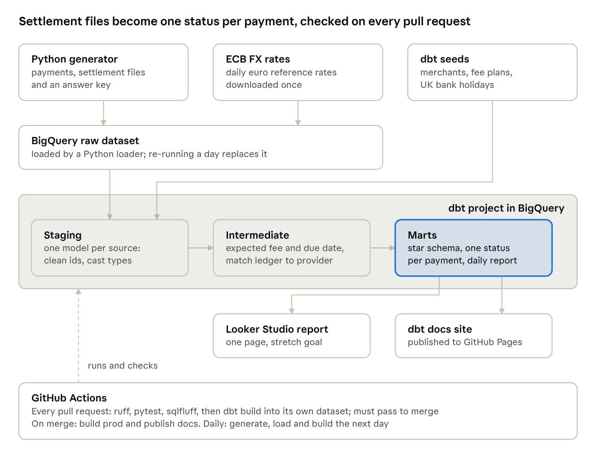

# Project plan

Build a dbt project on BigQuery that reconciles a payment provider's settlement files against a company's own payment records. Target: v1.0 by Sunday 13 December 2026.

v1.0 is done when all of these are true:

- Anyone can clone the repo, follow the README and run it end to end in under 15 minutes.
- Every change reached `main` through a pull request with a description, and CI (lint, Python tests, `dbt build`) passed on each one.
- The reconciliation finds every problem the generator planted, proved by a test against an answer key.
- dbt docs are published online, with a description on every model and column in the marts.
- No real company data, client names or employer code anywhere in the repo or its history.

## The business problem

A fictional UK payments company, "Northgate Pay", takes card payments for about 40 merchants in five currencies: GBP, EUR, USD, SEK and JPY. Its payment provider sends a settlement file each business day listing what it paid out, less fees, converted into each merchant's settlement currency.

Finance needs to answer four questions every morning:

1. Was every payment we recorded settled, and was anything settled that we never recorded?
2. Was each one settled at the right amount, after the agreed fee and at a fair FX rate?
3. What is still outstanding, how old is it, and is any of it late?
4. How much cash did we receive yesterday in each currency?

JPY is in the list on purpose: it has no minor unit, so it catches rounding code that assumes two decimal places.

## Architecture



Everything runs on free or near-free tools: dbt Core, BigQuery inside its free allowance, and GitHub Actions on a public repo.

## Data

A Python generator creates six months of data (1 June to 30 November 2026), about 50,000 payments. It takes a random seed, so the same seed always gives the same files, and it writes an answer key of every problem it planted.

| Dataset | Grain | Source | Notes |
| --- | --- | --- | --- |
| `payments` | one row per payment, refund or chargeback | generator | internal ledger: payment id, merchant, amount, currency, created time, type, linked payment id for refunds |
| `settlement_lines` | one row per line in the provider's daily file | generator, one CSV per business day | provider's reference, our payment id, gross, fee, net, settlement currency, FX rate used, settlement date |
| `fx_rates` | one row per currency per day | [ECB euro reference rates](https://www.ecb.europa.eu/stats/policy_and_exchange_rates/euro_reference_exchange_rates/html/index.en.html), downloaded once | EUR based, so other pairs are worked out through EUR; no rates at weekends, so carry Friday's forward |
| `merchants` | one row per merchant | dbt seed | name, country, settlement currency, fee plan |
| `fee_plans` | one row per plan | dbt seed | percentage plus fixed fee, with start and end dates |
| `bank_holidays` | one row per date | dbt seed | UK holidays, for business-day maths |
| `answer_key` | one row per planted problem | generator | used only by tests, never by models |

Raw files land in a `raw` BigQuery dataset through a small Python loader, loaded idempotently (re-running a day replaces that day, never doubles it).

The generator plants these problems at known rates, roughly 3% of payments in total:

- settlement never arrives
- same payment settled twice
- fee charged twice, or wrong fee plan used
- provider used an FX rate outside tolerance
- settled later than the agreed two business days
- refunds and chargebacks, some settled and some not
- settlement line with a payment id we never recorded
- a payment id with stray spaces or different case in the provider file (it should still match)

## Matching rules

Each payment gets exactly one status, decided in the order below, so a payment that is both late and short is reported as an amount mismatch first. Match on the cleaned payment id (trimmed, upper case); the provider's reference is the fallback.

| Order | Status | Rule | Tolerance |
| --- | --- | --- | --- |
| 1 | Unrecorded settlement | settlement line whose payment id is not in our ledger | none |
| 2 | Duplicate settlement | more than one settlement line for the same payment | none |
| 3 | Missing settlement | no settlement line and older than 2 business days | not yet due counts as Pending |
| 4 | Amount mismatch | net settled differs from gross minus the expected fee | 0.01 in settlement currency (1 for JPY) |
| 5 | FX mismatch | provider's rate differs from the ECB-derived rate | more than 0.5% |
| 6 | Late settlement | settled after 2 business days, skipping weekends and UK holidays | none |
| 7 | Matched | everything above passes | |
| 8 | Pending | not settled yet, still within 2 business days | |

Refunds and chargebacks follow the same rules, matched to negative settlement lines. Tolerances and the business-day limit live in `dbt_project.yml` as variables, so they can be changed without touching SQL. Each rule's reason goes in the model's description.

## dbt models

Three layers, following dbt's recommended structure: staging cleans one source each, intermediate does the joins and logic, marts are what finance reads. Staging are views; intermediate and marts are tables.

| Layer | Model | Grain | What it does |
| --- | --- | --- | --- |
| Staging | `stg_payments` | payment | rename, cast types, clean ids, amounts in minor units |
| Staging | `stg_settlement_lines` | settlement line | same, plus file date |
| Staging | `stg_fx_rates` | currency, day | fill weekends and holidays with the last rate |
| Intermediate | `int_fx_rates_daily` | currency pair, day | cross rates through EUR |
| Intermediate | `int_expected_settlement` | payment | expected fee, expected net, due date |
| Intermediate | `int_settlement_matches` | payment | joins ledger to settlement lines, counts matches |
| Marts | `dim_merchant` | merchant | from seeds |
| Marts | `dim_currency` | currency | code, decimal places |
| Marts | `dim_date` | day | business day flag, UK holidays |
| Marts | `fct_payments` | payment | amounts in original and GBP |
| Marts | `fct_settlements` | settlement line | amounts, fees, FX used |
| Marts | `fct_reconciliation` | payment | status, reason, days to settle, difference |
| Marts | `rpt_daily_reconciliation` | day, currency | matched value, unmatched value by status, average days to settle |

Model contracts (enforced column types) on the marts, and an exposure that names the Looker Studio page as their consumer.

## Testing

The most important test compares the reconciliation's output with the generator's answer key: every planted problem must come out with the right status, and nothing clean may be flagged.

| Kind | Where | Examples |
| --- | --- | --- |
| Python unit tests | pytest, on the generator and loader | same seed gives the same files; planted rates within range; loading a day twice gives one copy |
| Source checks | dbt sources | freshness on settlement files; ids not null |
| Generic tests | every model's yml | `unique` and `not_null` on keys; `relationships` from facts to dims; `accepted_values` on status |
| Business rules | dbt_utils | gross minus fee equals net on every settlement line; every payment has exactly one status |
| Totals tie | singular test | total of ledger equals matched plus every unmatched status, per currency per day |
| Answer key | singular test | statuses match the answer key, row for row |
| Threshold | custom generic test | fails if unmatched value for a day goes over a set amount (a warning, not an error) |
| Unit tests | dbt unit tests | the matching model on a handful of hand-written rows, one per status |

## Engineering workflow

Every change starts as a GitHub issue, goes on its own branch, and reaches `main` only through a pull request that CI has passed.

```
payments-reconciliation-dbt/
  generator/          Python: makes the data, plus pytest tests
  loader/             Python: loads raw files to BigQuery
  payments_recon/     dbt project: models/, seeds/, tests/, macros/, dbt_project.yml
  .github/workflows/  ci.yml, deploy.yml, daily.yml
  .github/pull_request_template.md
  docs/               plan, setup guide, architecture diagram, decisions log
  README.md
```

**BigQuery datasets:** `raw` for loaded files, `dev` for local runs, `ci_pr_<number>` made fresh for each pull request and dropped afterwards, and `prod` built only from `main`. Location: europe-west2 (London).

**CI, on every pull request:**

1. ruff (Python lint) and pytest
2. sqlfluff on the dbt SQL
3. `dbt build` into that pull request's own dataset, so a broken model or failing test blocks the merge
4. drop the pull request's dataset

**On merge to main:** `dbt build` into `prod`, then generate dbt docs and publish them to GitHub Pages.

**Daily:** a scheduled GitHub Actions run generates the next day's files, loads them and runs `dbt build`.

**Credentials:** CI signs in to Google Cloud with Workload Identity Federation, so no service account key is stored in GitHub. Fallback: a key held as a GitHub secret, never in the repo.

**Habits:** branch protection on `main` (pull request and green checks required), a pull request template (what, why, how tested), small pull requests, pre-commit hooks for ruff and sqlfluff, pinned package versions, and a decisions log in `docs/decisions.md`.

## Schedule

| Week | Dates | Milestone at the end |
| --- | --- | --- |
| 1 | Tue 24 to Sun 29 Nov | Repo set up, CI green, generated data loaded into BigQuery |
| 2 | Mon 30 Nov to Sun 6 Dec | Star schema built; first five statuses working with tests |
| 3 | Mon 7 to Sun 13 Dec | v1.0: all statuses, answer key test passing, docs online, README finished |
| Stretch | Mon 14 to Sun 20 Dec | Cash position and forecast, Looker Studio page |

**Week 1: foundations**

- [ ] Repo, branch protection, pull request template, an issue for each task below
- [ ] Python environment, pinned `dbt-bigquery`, pre-commit with ruff and sqlfluff
- [ ] BigQuery datasets and a CI identity with Workload Identity Federation
- [ ] `dbt init`, one placeholder model, CI workflow running `dbt build` on a pull request
- [ ] Generator with seed and answer key, plus pytest tests
- [ ] Download ECB rates; loader that replaces a day rather than duplicating it

**Week 2: modelling**

- [ ] Sources with freshness checks, seeds for merchants, fee plans and holidays
- [ ] Staging models with tests
- [ ] `dim_date`, `dim_currency`, `dim_merchant`, `fct_payments`, `fct_settlements`
- [ ] `int_expected_settlement`, `int_settlement_matches`
- [ ] `fct_reconciliation` with Unrecorded, Duplicate, Missing, Matched and Pending
- [ ] Totals-tie test

**Week 3: finish and polish**

- [ ] Amount, FX and Late statuses, with refunds and chargebacks
- [ ] Answer key test, dbt unit tests, threshold test
- [ ] `rpt_daily_reconciliation`
- [ ] Merge workflow: build prod, publish dbt docs to GitHub Pages
- [ ] Daily scheduled run
- [ ] README with diagram, results table and decisions log

## Stretch: treasury view

Only after v1.0.

- `rpt_daily_cash_position`: cash received per day per settlement currency, plus value still outstanding by age (0 to 2, 3 to 5, over 5 business days).
- A 30-day cash forecast per currency with BigQuery ML `ARIMA_PLUS`. Generated data makes this a demonstration, not a finding.
- One incremental model (`fct_settlements`, merged by settlement line) with a test that a full rebuild and an incremental run give the same result.
- A one-page Looker Studio report: matched rate, unmatched value by status, ageing, cash forecast.

## Risks

| Risk | What happens | Fallback |
| --- | --- | --- |
| Workload Identity Federation setup takes too long | Week 1 slips | Service account key stored as a GitHub secret, swapped later |
| Matching logic grows complicated | Week 3 slips | Ship v1.0 with fewer statuses, all tested; add the rest after |
| Weeks with less free time | Dates move | Week 2's version is the minimum; keep the stretch as stretch |
| BigQuery costs | Unexpected bill | Budget alert set; data under 100 MB; CI datasets dropped after each run |
